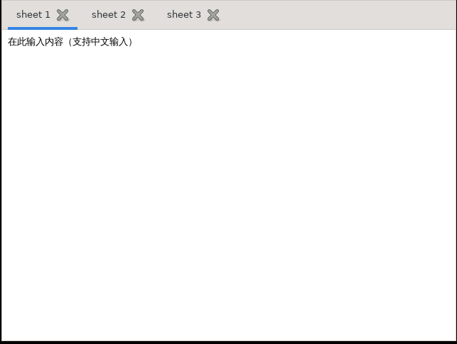

# EvoBuddy

A GTK 3 desktop application written in Rust with [gtk-rs](https://gtk-rs.org/),
replicating the UI of the Tencent WorkBuddy AI desktop client.

The app is `evobuddy` (display name **EvoBuddy**). The repository also keeps the
upstream `notebook` example from
[gtk3-rs](https://github.com/gtk-rs/gtk3-rs/tree/master/examples/notebook) as the
validated GTK 3 + CJK-input baseline; it now lives in
`crates/eb/src/bin/notebook/` and is documented further down.

```bash
cargo run                 # runs evobuddy (default-run)
cargo run --bin notebook  # the CJK baseline demo
```

## Requirements

- Rust (edition 2021, stable toolchain)
- GTK 3 development libraries

### Installing GTK 3

**macOS (Homebrew):**

```bash
brew install gtk+3
export PKG_CONFIG_PATH="/opt/homebrew/lib/pkgconfig:$PKG_CONFIG_PATH"
```

**Debian / Ubuntu:**

```bash
sudo apt install libgtk-3-dev
```

**Fedora:**

```bash
sudo dnf install gtk3-devel
```

## Build and run

```bash
cargo run --bin notebook
```

## The EvoBuddy shell

`evobuddy` is the actual application: a UI replica of the WorkBuddy AI desktop
client, rebuilt against live CDP captures of the real client rather than guessed
from class names. The measurements, the design-token system and the legal
boundaries are written up in [`docs/ui-spec/ui-spec.md`](docs/ui-spec/ui-spec.md)
(§4.3 for the welcome screen, §4.4 for the conversation screen).

So far it implements two states of the main workspace:

- **Welcome screen** — sidebar + centred landing column (hero, `Work | Code`
  segmented control, suggestion chips, composer).
- **Conversation screen** — a three-pane layout: sidebar 280 | conversation 580 |
  artifact panel 580, with a captured chat state (user/agent turns, a collapsed
  tool row, a table block, the composer, and a file artifact in the panel).

Sending from the welcome screen creates a task, opens the conversation and opens
the artifact panel. Product copy, icons and the mascot are **not** reproduced;
EvoBuddy has its own placeholder wording and text-glyph icons.

### Smoke test

GTK fails *silently* in the ways that matter here: one malformed line discards
the entire stylesheet, and a misspelled `@define-color` name quietly falls back
to the default theme — both still look like a plausible UI. So there is a
self-test:

```bash
EB_SELFTEST=1 cargo run
```

It prints whether the CSS parsed, resolves the colour names the shell depends
on, and reports the absolute geometry of every probed widget, then quits. Add
`EB_SHOT=<path.png>` to also render the window to a PNG via Cairo — that is the
only check that catches a colour applied to the wrong node or text clipped by a
too-small allocation:

```bash
EB_DEMO=1 EB_SELFTEST=1 EB_SHOT=/tmp/evobuddy-chat.png cargo run
# second demo answer: diff + exec + table, 752px column
EB_DEMO_BLOCKS=1 EB_SELFTEST=1 EB_SHOT=/tmp/evobuddy-blocks.png cargo run
```

`EB_DEMO=1` submits a message first, so the conversation state is photographed
too. `EB_ENTER=1` verifies the other half — that Enter actually sends — by
synthesising a Return, and prints the route before and after:

```bash
EB_ENTER=1 EB_SELFTEST=1 cargo run
# enter: before=welcome hint-cleared=true
# enter: after=conversation (want conversation), buffer="Ask anything…"
```

Any harness flag (`EB_SELFTEST`, `EB_SHOT`, `EB_ENTER`, `EB_CLICK`,
`EB_CLICK_ASSERT`, `EB_ASSERT`, `EB_DEMO`) attaches the harness, so the explicit
`EB_SELFTEST=1` is only needed when none of those is set. The fake-agent demo
(`EB_FAKE_DEMO`) is its own mode and does not go through the selftest harness;
`EB_FAKE_*` and `EB_CANCEL_AFTER_MS`/`EB_DEBUG` are runtime switches.

`EB_CLICK=1` walks the shell and clicks the main interactive surfaces in turn,
printing what changed after each one — the closest thing here to a person poking
at the UI:

```bash
EB_CLICK=1 cargo run
# click: chip[0]                  composer="Help me plan and build a small desktop utility."
# click: segmented 'Code'         active segments: [1]
# click: sidebar collapse         sidebar visible=false reveal visible=true (glyph "▶" visible=true)
# click: sidebar search           ... menu open: visible=true alloc=324x80, notice="Global search is …"
# click: artifact tab close (x)   detail visible=false tabs=1
```

It prints by default, and you read the column. `EB_CLICK_ASSERT=1` turns the
stable observations — route, visibility, notice copy, menu rows — into an
exit-code assertion, which is what the Linux and macOS verify scripts use. The
numeric columns that move with the window server, fonts and layout timing are
deliberately not asserted. `EB_CLICK_SIGNAL=1` emits `clicked` directly
instead of synthesising a press and a release with a window and a device.

`EB_ASSERT=1` does the same for the geometry report: it asserts the fixed
measured blocks and checks that every colour resolved, then exits non-zero on a
mismatch. It skips the exact window size only when the screen is too small and
GTK is right to clamp the window. CI runs it alongside the screenshot.

For the full local launch + plugin checklist (manual UI passes, plugin boundary
checks and troubleshooting), see
[`docs/local-verification.md`](docs/local-verification.md).

### Real ACP agents

When `EVOBUDDY_ACP_COMMAND` is set, the host mounts
`eb-plugin-acp-agent` instead of the demo agent. It launches an
[Agent Client Protocol](https://agentclientprotocol.com) agent over JSON-RPC
stdio, creates one persistent session per app launch, and maps
`session/update` into the same `Delta`/`Block`/`Usage` events the renderer
already understands. dsh, opencode and other ACP-speaking agents are supported
without code changes.

```bash
# opencode's ACP mode
EVOBUDDY_ACP_COMMAND="$HOME/.opencode/bin/opencode" EVOBUDDY_ACP_ARGS="acp" EVOBUDDY_ACP_CWD="$PWD" cargo run

# dsh's ACP profile (see docs/acp-agent.md for the checkout path)
EVOBUDDY_ACP_COMMAND="$DSH/node_modules/.bin/pnpm" EVOBUDDY_ACP_ARGS="dsh --profile acp" EVOBUDDY_ACP_CWD="$DSH" DEEPSEEK_API_KEY="…" cargo run
```

Tool permissions open a modal allow/reject dialog by default; `EVOBUDDY_ACP_AUTO_APPROVE=1` bypasses the dialog;
`EVOBUDDY_ACP_DEBUG=1` forwards the agent's stderr. The full env table, event
mapping, permission model and limitations are in
[`docs/acp-agent.md`](docs/acp-agent.md).

`EB_FAKE_AGENT=1` replaces the demo agent with a slow streaming one. The
`EB_FAKE_DEMO=1` harness submits a prompt, waits for the terminal event and
quits; `EB_CANCEL_AFTER_MS` cancels via the API, `EB_FAKE_STOP_AFTER_MS` clicks
the send/stop button, and `EB_FAKE_PANIC_START=1` verifies a panicking start is
turned into a `Failed` event. This is how the event/cancel paths are exercised
without a real model:

```bash
EB_FAKE_AGENT=1 EB_FAKE_DEMO=1 EB_DEBUG=1 cargo run
EB_FAKE_AGENT=1 EB_FAKE_DEMO=1 EB_DEBUG=1 EB_CANCEL_AFTER_MS=300 \
  EB_FAKE_AGENT_CHUNKS=50 cargo run
EB_FAKE_AGENT=1 EB_FAKE_DEMO=1 EB_DEBUG=1 EB_FAKE_STOP_AFTER_MS=250 \
  EB_FAKE_AGENT_CHUNKS=50 cargo run
EB_FAKE_AGENT=1 EB_FAKE_DEMO=1 EB_DEBUG=1 EB_FAKE_PANIC_START=1 cargo run
```

`EB_FAKE_AGENT_DELAY_MS` (default 120) and `EB_FAKE_AGENT_CHUNKS` (default 8)
control the stream. For a live window, run `EB_FAKE_AGENT=1 cargo run`, click a
chip and press Enter; the streaming footer and chunks arrive while the rest of
the UI stays interactive, and the send button becomes a stop button.

For ACP screenshots, `EB_ACP_DEMO=1` submits once and leaves the window open;
`EB_SHOT_AFTER_MS=1500` delays the capture until the agent stream settles:

```bash
EVOBUDDY_ACP_COMMAND=python3 EVOBUDDY_ACP_ARGS="$PWD/crates/plugins/eb-plugin-acp-agent/tests/fixtures/fake_acp.py" EB_ACP_DEMO=1 EB_PERMISSION_AUTO=allow \
EB_SHOT=/tmp/evobuddy-acp.png EB_SHOT_AFTER_MS=1500 cargo run
```

Popovers are not in the widget walk — GTK parents them to the window when they
pop up — so the audit reads them through the input grab instead.
`EB_MENU_SHOT=<path.png>` renders one open menu: the only way to see that a
dropdown has *content*, because a popover whose children were never shown still
has chrome and still reports `visible=true`.

Renders can also be read as pixels rather than looked at:
`node docs/ui-spec/pngpx.js <file.png> [rows] [cols]` prints a grid of RGB
values. That is how the Linux bundle's screenshot was checked against the
measured colours (`#f7f7f7` sidebar, `#ffffff` route) — and how a stripe that
looked wrong turned out to be an artefact of the image viewer rather than
anything in the file. Capturing the X server's root window instead (`xwd` piped
through `netpbm`) is not a substitute: under Xvfb it produced sheared,
unreliable images.

Synthesising that key needs care, which is why the flag exists. GTK drops key
events whose window is missing or unmapped (`event_window_is_still_viewable`),
silently, before any handler runs; and `gtk_test_widget_send_key` cannot target
the editor at all, because it resolves the keymap through
`gtk_widget_get_window` — and a text view is a windowless widget. So the harness
builds a `GdkEventKey`, attaches the toplevel's window to it, and delivers it to
the editor. The composer's focus-in also has to be faked: GTK only sends it to
the toplevel's focus widget when the window is *active*, which a bare
`cargo run` has no window manager to arrange.

Both run from an idle callback on purpose: a widget receives `::size-allocate`
before its children are allocated, so reading layout from the signal handler
sees a half-built tree. The screenshot path also re-runs allocation with the
window's current size before drawing: `gtk_widget_draw` *silently draws nothing*
for a widget whose allocation is still pending, and GTK's own paint path never
hits that assertion, so the bug is invisible in the running app and shows up
only as an empty PNG (spec §10-17).

Two GTK traps found by that audit are worth knowing before touching this code,
because both look like \"that control is broken\" and neither raises anything:

- `gtk_widget_show_all()` **returns immediately** for a widget marked
  `no_show_all`, and does not descend into it either. So a popover or a button
  hidden that way and shown later has *never shown its children*: the dropdown
  pops up as an empty box (a constant 66x42 requisition, whatever it holds) and
  the button renders as a blank square. `widgets::hide_from_show_all()` shows the
  subtree first and only then opts it out; the same ordering applies to folding
  a section, which is why `sidebar::fill_content` hides collapsed bodies *after*
  its `show_all()`.
- A non-wrapping `GtkTextView` reports the width of the lines it has *laid out*,
  and it can never lay out more than it was allocated — so its request settles at
  the allocation and a long line is clipped with nothing to scroll to. The
  artifact panel measures its widest line with Pango and requests that width.

### Files

| path | role |
| ---- | ---- |
| `crates/eb/` | the GTK **host**: window, renderers, wiring, the `EB_*` harness |
| `crates/eb/src/main.rs` | thin entry point: CSS, window, wiring, `EB_*` switches |
| `crates/eb/src/spec.rs` | every measured geometry literal, plus the shell's chrome copy |
| `crates/eb/src/shell.rs` | assembly, the paned three-pane layout, repaint |
| `crates/eb/src/welcome.rs`, `conversation.rs`, `detail.rs` | the three regions' renderers |
| `crates/eb/src/sidebar.rs`, `composer.rs`, `widgets.rs` | shared pieces |
| `crates/eb/src/selftest.rs` | the `EB_*` harness: geometry probe, screenshots, Enter test and the click audit |
| `crates/eb/src/agent.rs` | the in-flight agent runner: drains `AgentEvent`s, applies them to `App`, handles cancel |
| `crates/eb-api/` | the **plugin surface**: data model, contribution registries, `EbPlugin` — the only crate a plugin may depend on |
| `crates/plugins/` | the built-in plugins: `nav`, `notices`, `composer`, `demo-agent`, `acp-agent` |
| `vendor/rutis/` | the vendored plugin runtime (narrowed tokio features; see its README) |
| `prototype/` | the measurement workspace that chose the plugin runtime (dsh compatibility experiments; not part of the build) |
| `crates/eb/ui/gtk.css` | colours, type, radii, shadows (GTK CSS is not web CSS — no `var()`, no `flex`, no `gap`) |
| `docs/ui-spec/gtk/` | generated `@define-color` sets (light/dark), built by `build_gtk_tokens.js` |
| `docs/ui-spec/capture_dom.js` | read-only CDP capture of the real client (DOM + computed styles) |
| `docs/ui-spec/query_layout.js` | query tool for that capture; reports CSS px |
| `docs/ui-spec/watch_dom.js` | continuous capture: dedupes DOM snapshots frame by frame |
| `docs/ui-spec/pngpx.js` | prints a grid of pixels from a PNG — the way to answer "is that stripe a stray element, an uninitialised surface or a font difference?" |
| `packaging/linux/` | builds and verifies the self-contained Linux bundle (Docker: glibc 2.28 build, bare-host test) |
| `packaging/macos/` | builds and verifies the self-contained `EvoBuddy.app` (Homebrew GTK3, rewritten load commands, prefix-hidden test) |

## Plugins

"Everything is a plugin" is enforced by the workspace layout: a plugin crate
depends on `eb-api` (plus data-only crates where unavoidable, such as
`serde_json` in the ACP plugin) and never on the host or GTK — Cargo will not
let it reach into the host, and the host never names a plugin's internals. A plugin's `mount` receives
a `Ui` handle and *declares* content — nav rows, dropdown menus, notice copy,
scenario chips — or *provides a service* (the demo/ACP agents implement
`AnswerSource`, the service behind the composer's send path).

An `AnswerSource` now starts an answer instead of returning one: `start` gets an
`AgentSink` and returns a cancel handle, then emits `Started`, `Delta`, `Block`,
`Artifact`, `Usage`, `Finished` or `Failed` events. `start` runs on
`AgentRuntime`'s dedicated thread (`crates/eb/src/agent.rs`); the `Runner`
drains its bounded event queue on the GTK main loop and applies events to `App`.
Plugin code still never touches a widget. While an answer streams, the send
button becomes a stop button (same 32x32 geometry).
The demo agent emits synchronously; `EB_FAKE_AGENT=1` swaps in a slow streaming
agent whose worker thread is the first real cross-thread producer.

The model is **data plugins, host rendering**: plugins produce plain values, the
host turns them into widgets. Plugin code never touches a widget, which keeps
the thread contract trivial and the pixel-faithful rendering in one place. The
runtime is [rutis](prototype/probes/README.md) (vendored): provider/consumer
services with dependency-gated restarts, an event bus whose dispatch modes
include a veto-able waterfall, and rollback on a failed mount. The
measurement workspace that selected it, and the separately-verified path for
hosting the dsh plugin ecosystem, live in `prototype/`.

## Self-contained Linux bundle

`packaging/linux/package.sh` compiles the app inside `debian:10` — glibc 2.28,
the oldest supported target, because the glibc symbols a binary asks for are
those of the environment it was built in — and stages a tree in `dist/app`: the
binary, 72 shared libraries (GTK 3, GLib, Pango, Cairo, HarfBuzz…), fonts, an
icon theme, compiled GSettings schemas, a placeholder icon, a `.desktop` entry,
an `install.sh`, and a `run` launcher that resolves every path relative to
itself. The same tree is tarred to `dist/evobuddy-<version>-linux-<arch>.tar.gz`,
and packed into `dist/evobuddy-<version>-linux-<arch>.AppImage` — one executable
file, no unpacking, which is the shape most people expect from a release
download. Each is published with a SHA-256 beside it.

`PLATFORM` defaults to the machine's own architecture, which is not just a
convenience: an AppImage carries `AI` in the ELF header byte `EI_ABIVERSION`,
and qemu and Rosetta reject that byte, so no AppImage can be built *or* run
under an emulation layer. CI builds each architecture on a runner of that
architecture.

`packaging/linux/verify.sh` then runs that tree on a *different*, bare Debian 10
— no GTK, no Pango, no Cairo, no fontconfig, no fonts — and prints what the host
still had to provide. The answer is six libraries, all glibc's own, deliberately
left to the system: they are forward compatible, and bundling libc breaks name
resolution. It runs the AppImage too, without FUSE, and requires it to render
byte-for-byte what the tree renders, so "the AppImage is the same program" is
checked rather than assumed. It also runs `install.sh`, because an installer
that is never exercised is an installer that ships broken — the first version of
it did.

Both scripts need Docker and nothing else; neither needs GTK on the host. What
the bundle has to contain, and the traps that cost time to find (the theme is
compiled into `libgtk-3-0`, schemas must be compiled *together with* their enum
files, two caches are full of build-time absolute paths), is written up in
[`packaging/linux/README.md`](packaging/linux/README.md).

The bundle asks glibc for `GLIBC_2.28` exactly: it runs on 2.28 and newer, with
no headroom below that.

## Self-contained macOS .app

`packaging/macos/bundle.sh` is the macOS counterpart: it builds the app against
the Homebrew GTK 3 stack, then rewrites every load command so `EvoBuddy.app`
runs on a Mac that has no Homebrew at all — verify.sh hides the prefix and runs
the geometry selftest to prove it. Text renders through the system font stack
(CoreText), which is what the spec's macOS measurements assumed; fonts are
deliberately not bundled there, unlike on Linux. The full list of what had to
be discovered — re-exported loaders, unsigned-code SIGKILLs, the death of
`DYLD_PRINT_*` — is in [`packaging/macos/README.md`](packaging/macos/README.md).

## Prebuilt binaries

Pushing a `v*` tag runs [`build.yml`](.github/workflows/build.yml): it calls the
same `package.sh` / `verify.sh` a developer runs locally, and publishes the
results as a GitHub release. Every push and pull request also runs
[`check.yml`](.github/workflows/check.yml) (`cargo test --workspace`), so a
broken test does not wait for the next tag.

| artifact                                  | built in                 | notes                                          |
| ----------------------------------------- | ------------------------ | ---------------------------------------------- |
| `evobuddy-<v>-linux-x86_64.AppImage`      | Debian 10 (glibc 2.28)   | one file, self-contained, glibc >= 2.28, x86_64 |
| `evobuddy-<v>-linux-x86_64.tar.gz`        | Debian 10 (glibc 2.28)   | the same tree, self-contained, x86_64           |
| `evobuddy-<v>-linux-aarch64.AppImage`     | Debian 10 (glibc 2.28)   | one file, self-contained, glibc >= 2.28, arm64  |
| `evobuddy-<v>-linux-aarch64.tar.gz`       | Debian 10 (glibc 2.28)   | the same tree, self-contained, arm64            |
| `evobuddy-<v>-macos-arm64.tar.gz`         | macOS 15 (Homebrew GTK3) | EvoBuddy.app inside, self-contained, Apple silicon |
| `evobuddy-<v>-macos-x86_64.tar.gz`        | macOS 15 Intel (Homebrew GTK3) | EvoBuddy.app inside, self-contained, Intel |
| `evobuddy-<v>-windows-x86_64.zip`         | MSYS2 UCRT64 + MinGW-w64 | Windows 10+; **not** self-contained yet         |

Every artifact has a `.sha256` beside it. The Windows zip is the odd one out by
necessity: GTK 3 cannot be linked into a single `.exe`, so it stays a folder.

The Linux artifacts *are* the bundle described above. CI does not merely
`cargo build` them: it builds the bundle and then runs it on a bare Debian 10,
so "self-contained" is enforced on every tag instead of remembered. The macOS
artifacts get the same treatment on their own runners: `verify.sh` audits every
load command in the .app and then runs it with the Homebrew prefix hidden —
see [`packaging/macos/README.md`](packaging/macos/README.md).

The Windows artifact is a soft failure on purpose, and its own README says so:
it carries every GTK 3 DLL but not GTK's *data* files (GSettings schemas, input
methods, the gdk-pixbuf loader cache), so a DLL-only zip will not start on a
machine without GTK installed. The Linux launcher rewrites those caches at run
time; doing the same for Windows needs a `.cmd` launcher and a real Windows
machine to test on.

Windows 7/8.1 — a stated requirement — is likewise unresolved: MSYS2 dropped
Windows 7/8.0 in May 2024 (`msys2-runtime` moved to Cygwin 3.5), and UCRT64
targets Windows 10+. Whether a MinGW-w64 GTK 3 build could still target Win7
(the build environment and the target machine are not the same thing) is
unknown. The spec records both as open gaps (§10-23, §10-24) rather than
guessing.

## Layout

```
.
├── .github
│   ├── scripts/build-windows.sh  # MSYS2 UCRT64 + MinGW-w64; unverified, see README
│   └── workflows/build.yml       # tag-only: bundle both platforms, test, publish
├── Cargo.toml
├── README.md
├── docs
│   └── ui-spec      # replication spec, design tokens, CDP capture/query tools
├── packaging
│   └── linux        # package.sh / verify.sh: glibc 2.28 build, bundle, bare-host test
├── screenshot.png        # macOS
├── screenshot-linux.png  # Linux
├── src
│   ├── main.rs      # `evobuddy`: entry point (CSS, window, wiring)
│   ├── spec.rs      # measured geometry + copy constants
│   ├── model.rs     # app state (scenes, routes, tasks, turns, artifacts)
│   ├── shell.rs     # assembly, three-pane layout, repaint
│   ├── welcome.rs   # welcome screen (sidebar + centred landing column)
│   ├── conversation.rs  # conversation pane (topbar, messages, table, tool row)
│   ├── detail.rs    # artifact panel (tabs, editor toolbar, gutter + code)
│   ├── sidebar.rs   # sidebar nav, sections and task rows
│   ├── composer.rs  # composer card, picker row, Enter-to-send
│   ├── widgets.rs   # shared helpers (hbox/vbox, classes, glyph buttons)
│   ├── selftest.rs  # EB_* harness (geometry, shots, click audit)
│   └── bin
│       └── notebook # the CJK baseline demo (main.rs + notebook.rs)
└── ui
    └── gtk.css      # shell stylesheet for `evobuddy`
```

## How the notebook demo works

- `main.rs` first calls `ensure_gtk_im_modules` (see
  [Chinese (CJK) input](#chinese-cjk-input)), then creates a `gtk::Application`
  (application id `com.github.gtk-rs.examples.notebook`), builds a 640x480
  `ApplicationWindow` on `activate`, and adds three pages to the notebook.
  `build_editor` builds each page as a `gtk::ScrolledWindow` wrapping a
  `gtk::TextView` (word/char wrapping, small margins); the buffer starts with a
  Chinese hint line.
- `notebook.rs` wraps `gtk::Notebook`. `create_tab` builds a tab header
  consisting of a label plus a close button, appends the page, and wires the
  close button to remove that page. The `Notebook` instance is captured weakly
  in the click handler (`glib::clone!`) so the signal connection does not keep
  the notebook alive.

## Chinese (CJK) input

Rendering and input come from two different places:

- **Rendering** — fontconfig sees the system CJK fonts (e.g. `Heiti SC`,
  `Songti SC`), so characters draw instead of tofu boxes. Nothing to do here.
- **Typing (IME)** — requires GTK to load its `im-quartz` input method module,
  which bridges to the macOS input methods (Pinyin, etc.).

### The macOS prefix trap

GTK deduces its installation prefix from the path of the *running executable*.
A cargo binary lives in `target/debug/`, i.e. outside the GTK install tree, so
GTK cannot find its `immodules.cache`. The input-method table is then empty, GTK
silently falls back to the "simple" context, and **IME input does nothing** — no
Chinese, no Japanese, no Korean. (Homebrew's own `gtk3-demo`, which lives inside
the Cellar, is unaffected, which is why the problem is easy to miss.)

This is visible directly — the module is only loaded once the cache is found:

```console
$ GTK_EXE_PREFIX=/nonexistent ./target/debug/notebook   # cache unreachable
$ lsof -p <pid> | grep immodules
# (nothing)

$ ./target/debug/notebook                                # default
$ lsof -p <pid> | grep immodules
.../immodules/im-quartz.so
```

`main.rs` handles this: before GTK is initialised, `ensure_gtk_im_modules` finds
the loaded libgtk with `dladdr`, derives its `lib/` directory, and points
`GTK_IM_MODULE_FILE` at `gtk-3.0/3.0.0/immodules.cache`. It is macOS-only and
defers to any `GTK_IM_MODULE_FILE` / `GTK_EXE_PREFIX` you set yourself.

To fix it externally instead of via the code:

```bash
export PKG_CONFIG_PATH="/opt/homebrew/lib/pkgconfig:$PKG_CONFIG_PATH"
export GTK_IM_MODULE_FILE="$(pkg-config --variable=libdir gtk+-3.0)/gtk-3.0/3.0.0/immodules.cache"
```

On Linux GTK locates its modules on its own, so no workaround is needed.

### Linux

Nothing platform-specific is required. On Linux `_gtk_get_libdir()` returns the
compile-time `GTK_LIBDIR`, so GTK always finds `immodules.cache` regardless of
where the binary lives — the macOS prefix trap does not exist, and
`ensure_gtk_im_modules` is a no-op there.

Input then depends on your desktop's IME framework being installed:

| distro family  | IME engine                              | CJK fonts               |
| -------------- | --------------------------------------- | ----------------------- |
| Debian/Ubuntu  | `sudo apt install ibus` (or `fcitx5`)   | `fonts-noto-cjk`        |
| Fedora         | `sudo dnf install ibus`                 | `google-noto-sans-cjk-fonts` |
| Arch           | `sudo pacman -S ibus`                   | `noto-fonts-cjk`        |

GTK then loads `im-ibus.so` (or the fcitx5 module) and the desktop's input
methods work as usual. If GTK picks the wrong engine, name the one you use:

```bash
GTK_IM_MODULE=ibus cargo run --bin notebook     # or fcitx5
```

Verified on Debian bookworm under Xvfb with `ibus` — it builds unchanged, loads
the IM module without any `GTK_IM_MODULE_FILE` / `GTK_EXE_PREFIX` workaround, and
renders CJK:

```console
$ cargo build --bin notebook
$ GTK_IM_MODULE=ibus ./target/debug/notebook
$ grep -o 'immodules/[a-z-]*\.so' /proc/<pid>/maps
immodules/im-ibus.so
```



## Notes

The upstream example targets the in-development `0.20` branch of gtk-rs, which
uses the attribute-based `glib::clone!` syntax. This project pins the released
`gtk` 0.19 crate, which depends on `glib` 0.22; that version still supports the
same attribute form, so `notebook.rs` matches upstream verbatim.
