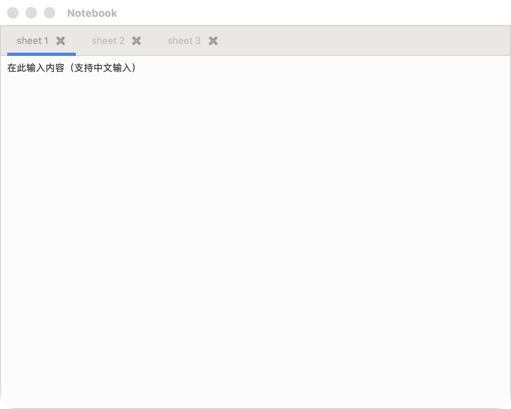

# Notebook

A GTK 3 desktop application written in Rust with [gtk-rs](https://gtk-rs.org/),
based on the upstream `notebook` example from
[gtk3-rs](https://github.com/gtk-rs/gtk3-rs/tree/master/examples/notebook).

It shows how to use `gtk::Notebook`. The window contains a tabbed notebook with
three sheets ("sheet 1", "sheet 2", "sheet 3"). Each page is a multi-line text
editor, and each tab header has a close button that removes the corresponding
page when clicked. The editors accept CJK input (e.g. Chinese typed through the
system IME).



## Requirements

- Rust (edition 2021, stable toolchain)
- GTK 3 development libraries

### Installing GTK 3

**macOS (Homebrew):**

```bash
brew install gtk+3
export PKG_CONFIG_PATH="/opt/homebrew/lib/pkgconfig:$PKG_CONFIG_PATH"
```

**Debian / Ubuntu:**

```bash
sudo apt install libgtk-3-dev
```

**Fedora:**

```bash
sudo dnf install gtk3-devel
```

## Build and run

```bash
cargo run --bin notebook
```

## Prebuilt binaries

Pushing a `v*` tag runs [`build.yml`](.github/workflows/build.yml) and publishes
the results as a GitHub release:

| artifact                       | built on                | notes                                     |
| ------------------------------ | ----------------------- | ----------------------------------------- |
| `notebook-linux-x86_64.tar.gz` | Debian 10 (glibc 2.28)  | runs on glibc >= 2.28, x86_64             |
| `notebook-linux-aarch64.tar.gz`| Debian 10 (glibc 2.28)  | runs on glibc >= 2.28, arm64              |
| `notebook-windows-x86_64.zip`  | MSYS2 MinGW-w64 GTK 3   | Windows 10+ x86_64, GTK 3 DLLs bundled    |

The Linux binaries are built inside a `debian:10` container, so they only
require glibc >= 2.28; the GTK 3 runtime itself (`libgtk-3-0` on Debian,
`gtk3` on Fedora) must be installed by the system. The Windows build zips every
required GTK 3 DLL next to `notebook.exe`, so it is self-contained.

Windows 7 is **not** supported: MSYS2 dropped Windows 7/8.0 in May 2024
(`msys2-runtime` moved to Cygwin 3.5), so there is no maintained GTK 3 runtime
for it.

## Layout

```
.
├── .github
│   ├── scripts             # build scripts run inside the CI containers/shells
│   └── workflows/build.yml # tag-only: build Linux + Windows, publish a release
├── Cargo.toml
├── README.md
├── screenshot.png        # macOS
├── screenshot-linux.png  # Linux
└── src
    ├── main.rs      # entry point: window + one text editor page per tab
    └── notebook.rs  # `Notebook` wrapper with closable tabs
```

## How it works

- `main.rs` first calls `ensure_gtk_im_modules` (see
  [Chinese (CJK) input](#chinese-cjk-input)), then creates a `gtk::Application`
  (application id `com.github.gtk-rs.examples.notebook`), builds a 640x480
  `ApplicationWindow` on `activate`, and adds three pages to the notebook.
  `build_editor` builds each page as a `gtk::ScrolledWindow` wrapping a
  `gtk::TextView` (word/char wrapping, small margins); the buffer starts with a
  Chinese hint line.
- `notebook.rs` wraps `gtk::Notebook`. `create_tab` builds a tab header
  consisting of a label plus a close button, appends the page, and wires the
  close button to remove that page. The `Notebook` instance is captured weakly
  in the click handler (`glib::clone!`) so the signal connection does not keep
  the notebook alive.

## Chinese (CJK) input

Rendering and input come from two different places:

- **Rendering** — fontconfig sees the system CJK fonts (e.g. `Heiti SC`,
  `Songti SC`), so characters draw instead of tofu boxes. Nothing to do here.
- **Typing (IME)** — requires GTK to load its `im-quartz` input method module,
  which bridges to the macOS input methods (Pinyin, etc.).

### The macOS prefix trap

GTK deduces its installation prefix from the path of the *running executable*.
A cargo binary lives in `target/debug/`, i.e. outside the GTK install tree, so
GTK cannot find its `immodules.cache`. The input-method table is then empty, GTK
silently falls back to the "simple" context, and **IME input does nothing** — no
Chinese, no Japanese, no Korean. (Homebrew's own `gtk3-demo`, which lives inside
the Cellar, is unaffected, which is why the problem is easy to miss.)

This is visible directly — the module is only loaded once the cache is found:

```console
$ GTK_EXE_PREFIX=/nonexistent ./target/debug/notebook   # cache unreachable
$ lsof -p <pid> | grep immodules
# (nothing)

$ ./target/debug/notebook                                # default
$ lsof -p <pid> | grep immodules
.../immodules/im-quartz.so
```

`main.rs` handles this: before GTK is initialised, `ensure_gtk_im_modules` finds
the loaded libgtk with `dladdr`, derives its `lib/` directory, and points
`GTK_IM_MODULE_FILE` at `gtk-3.0/3.0.0/immodules.cache`. It is macOS-only and
defers to any `GTK_IM_MODULE_FILE` / `GTK_EXE_PREFIX` you set yourself.

To fix it externally instead of via the code:

```bash
export PKG_CONFIG_PATH="/opt/homebrew/lib/pkgconfig:$PKG_CONFIG_PATH"
export GTK_IM_MODULE_FILE="$(pkg-config --variable=libdir gtk+-3.0)/gtk-3.0/3.0.0/immodules.cache"
```

On Linux GTK locates its modules on its own, so no workaround is needed.

### Linux

Nothing platform-specific is required. On Linux `_gtk_get_libdir()` returns the
compile-time `GTK_LIBDIR`, so GTK always finds `immodules.cache` regardless of
where the binary lives — the macOS prefix trap does not exist, and
`ensure_gtk_im_modules` is a no-op there.

Input then depends on your desktop's IME framework being installed:

| distro family  | IME engine                              | CJK fonts               |
| -------------- | --------------------------------------- | ----------------------- |
| Debian/Ubuntu  | `sudo apt install ibus` (or `fcitx5`)   | `fonts-noto-cjk`        |
| Fedora         | `sudo dnf install ibus`                 | `google-noto-sans-cjk-fonts` |
| Arch           | `sudo pacman -S ibus`                   | `noto-fonts-cjk`        |

GTK then loads `im-ibus.so` (or the fcitx5 module) and the desktop's input
methods work as usual. If GTK picks the wrong engine, name the one you use:

```bash
GTK_IM_MODULE=ibus cargo run --bin notebook     # or fcitx5
```

Verified on Debian bookworm under Xvfb with `ibus` — it builds unchanged, loads
the IM module without any `GTK_IM_MODULE_FILE` / `GTK_EXE_PREFIX` workaround, and
renders CJK:

```console
$ cargo build --bin notebook
$ GTK_IM_MODULE=ibus ./target/debug/notebook
$ grep -o 'immodules/[a-z-]*\.so' /proc/<pid>/maps
immodules/im-ibus.so
```


## Notes

The upstream example targets the in-development `0.20` branch of gtk-rs, which
uses the attribute-based `glib::clone!` syntax. This project pins the released
`gtk` 0.19 crate, which depends on `glib` 0.22; that version still supports the
same attribute form, so `notebook.rs` matches upstream verbatim.
